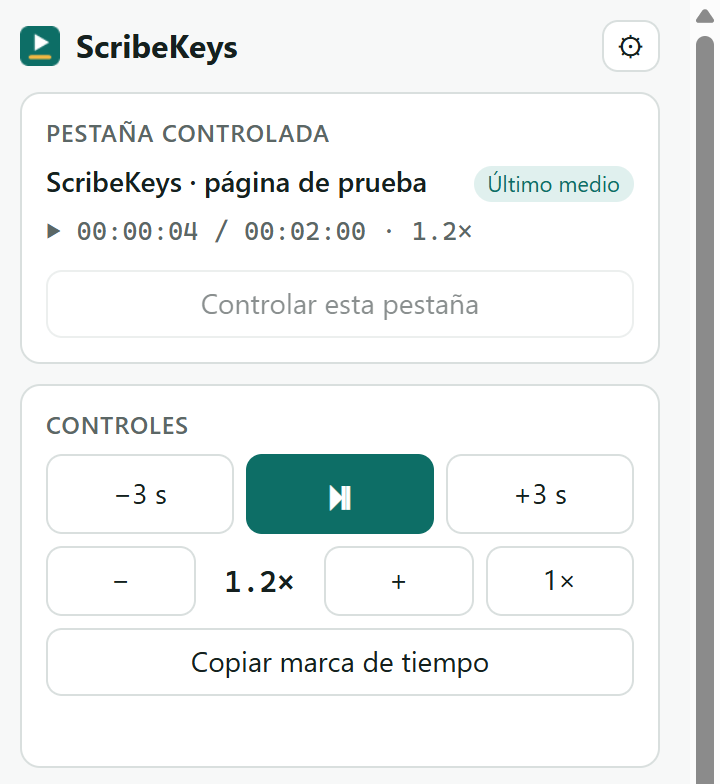
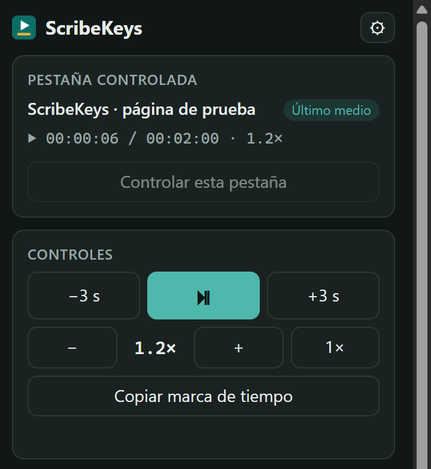
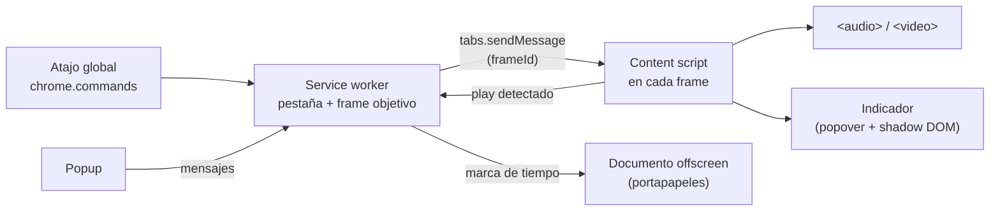

# ScribeKeys

**Español** · [English](#english)

Extensión de Chrome (Manifest V3) para transcriptores: controla el audio o video que ya se está reproduciendo en una pestaña —YouTube, Google Drive, plataformas de transcripción o cualquier `<audio>`/`<video>`— con **atajos de teclado globales** que funcionan aunque estés escribiendo en Word, en Google Docs o en otra ventana.

<p>
  
  
</p>

## Qué hace

| Acción | Atajo sugerido | Detalle |
|---|---|---|
| Reproducir / pausar | `Ctrl+Shift+1` | Al pausar retrocede 2 s (configurable 0–5 s), como Express Scribe. |
| Retroceder | `Ctrl+Shift+2` | 3 s por defecto (configurable). |
| Adelantar | `Ctrl+Shift+3` | 3 s por defecto (configurable). |
| Copiar marca de tiempo | `Ctrl+Shift+4` | Copia `[hh:mm:ss]` al portapapeles, aunque la página no tenga el foco. También `[mm:ss]` y sin corchetes. |
| Bajar / subir velocidad | sin asignar | Pasos de 0.1× entre 0.5× y 2×. |
| Velocidad normal | sin asignar | Vuelve a 1×. |

Al usar un atajo aparece sobre el medio un indicador breve (`⏸ −2 s`, `−3 s`, `0.8×`, `⧉ [00:12:34]`); se puede desactivar.

## En qué se diferencia

| | ScribeKeys | [Video Speed Controller](https://github.com/igrigorik/videospeed) | [Transcription Helper](https://chromewebstore.google.com/detail/chmkgbchecaliljnmpkdencihbopeodo) |
|---|---|---|---|
| Atajos con la página sin foco (escribiendo en otra ventana) | ✅ globales | ❌ solo con la página enfocada | ✅ |
| Controla el medio que ya está en la página (YouTube, Drive…) | ✅ | ✅ | ❌ carga el audio en su propio reproductor |
| Retroceso automático al pausar | ✅ | ❌ | ❌ |
| Copiar marca de tiempo | ✅ | ❌ | ❌ |
| Permisos | solo los sitios que actives | todos los sitios | todos los sitios |
| Última actualización | 2026 | activa | 2012 |

Video Speed Controller es excelente para ver videos a otra velocidad; ScribeKeys está pensado para **transcribir**: el teclado está en tu editor y el audio en otra pestaña.

## Instalación (extensión descomprimida)

1. Descarga `scribekeys-vX.Y.Z.zip` de la [última versión](https://github.com/Issanchez1790/scribekeys/releases/latest) y descomprímelo (o clona el repositorio).
2. Abre `chrome://extensions` y activa el **Modo de desarrollador** (arriba a la derecha).
3. Pulsa **Cargar descomprimida** y elige la carpeta `scribekeys` (la que contiene `manifest.json`). No borres la carpeta después: Chrome la sigue usando.
4. Se abrirá la página de opciones. Fija el ícono de ScribeKeys en la barra con el ícono del rompecabezas.

Requiere Chrome 116 o posterior.

## Configurar los atajos

Chrome tiene tres reglas que conviene conocer:

- Una extensión solo puede **sugerir** combinaciones `Ctrl+Shift+[0–9]` como atajos globales, y **como máximo cuatro**. Por eso solo reproducir/pausar, retroceder, adelantar y copiar marca de tiempo vienen asignados; los de velocidad los asignas tú.
- Para que un atajo funcione con Chrome en segundo plano, su ámbito debe ser **Global**.
- Si otra extensión ya usaba una combinación sugerida, Chrome la deja sin asignar. El popup muestra «sin asignar» en ese caso.

Pasos:

1. Abre el popup → **Configurar atajos** (o ve a `chrome://extensions/shortcuts`).
2. En **ScribeKeys**, asigna una combinación a cada acción.
3. En el desplegable de cada atajo elige **Global**.

> Un atajo global captura la combinación **en todo el sistema**: mientras ScribeKeys la tenga, tu editor no la recibirá. Por eso se evitan `Ctrl+Shift+0` (cambio de idioma del teclado en Windows) y `Ctrl+Shift+7/8/9` (listas en Google Docs). Los atajos globales funcionan mientras Chrome esté abierto, aunque esté minimizado; no están disponibles en ChromeOS.

## Uso

1. Abre el sitio con el audio o video y pulsa **Activar en este sitio** en el popup. Chrome te pedirá permiso solo para ese sitio.
2. Reproduce el medio una vez. Esa pestaña pasa a ser la **pestaña controlada**.
3. Vuelve a tu editor y usa los atajos.

**¿Qué pestaña se controla?** Por orden: la que fijes con **Controlar esta pestaña**, la última en la que se reprodujo un medio y, como respaldo, una pestaña con sonido. Dentro de la página se elige el medio que está sonando o, si no, el último reproducido, incluidos los que están en iframes, los añadidos después de cargar y los de shadow roots abiertos.

**Reproductores incrustados.** Algunas páginas (por ejemplo, Google Drive o una plataforma que incrusta YouTube) reproducen el medio dentro de un iframe de otro dominio. El popup detecta esos iframes y ofrece **Activar también** para ese dominio.

## Permisos y por qué se piden

| Permiso | Por qué |
|---|---|
| `storage` | Guardar tu configuración (`storage.sync`) y qué pestaña se controla (`storage.session`). |
| `scripting` | Registrar el script de control solo en los sitios que actives y localizar el medio entre los iframes. |
| `offscreen` + `clipboardWrite` | Copiar la marca de tiempo aunque estés en otra ventana. `navigator.clipboard` exige que la página tenga el foco; un documento offscreen no. |
| `activeTab` | Solo al abrir el popup: saber en qué sitio estás y detectar reproductores incrustados. |
| `optional_host_permissions` (`http(s)://*/*`) | **No se concede al instalar.** Es el techo de lo que se *puede* pedir; cada sitio se pide por separado cuando pulsas «Activar en este sitio». Puedes ver y quitar los sitios en Opciones o en `chrome://extensions`. |

No se pide `tabs`, ni `<all_urls>`, ni `host_permissions` fijos, ni `notifications`.

## Privacidad

- Sin peticiones de red, sin analítica y sin servidores. Un test comprueba que el código no usa `fetch`, `XMLHttpRequest`, `WebSocket` ni URLs remotas.
- No lee el contenido de las páginas: solo interactúa con los elementos `<audio>`/`<video>` de los sitios que actives.
- La configuración se guarda en `chrome.storage.sync`, que Chrome sincroniza con tu cuenta si tienes la sincronización activada. Las marcas de tiempo solo van a tu portapapeles.

## Limitaciones conocidas

- Medios que no son elementos del DOM: `new Audio()` sin insertar en la página, o reproductores basados solo en Web Audio API.
- Medios dentro de shadow roots **cerrados**.
- Chrome no permite extensiones en `chrome://`, la Chrome Web Store ni el visor de PDF.
- Algunos reproductores (como el de YouTube) no actualizan su propio indicador de velocidad cuando la cambia ScribeKeys, aunque la velocidad sí cambia.
- El retroceso automático solo se aplica al pausar con el atajo o con el popup, no al pausar desde la propia página.
- Si desactivas un sitio, el script ya cargado en sus pestañas abiertas sigue presente hasta que las recargues.

## Lista de verificación manual

Usa la página de prueba: `npm run serve:demo` y abre <http://localhost:8080/test/demo.html>. Cada medio emite un clic por segundo y un doble pitido cada 10 s, con un tono distinto por medio.

- [ ] La extensión carga sin errores en `chrome://extensions` y abre las opciones al instalarse.
- [ ] El popup muestra 4 atajos asignados y 3 «sin asignar».
- [ ] En la demo, **Activar en este sitio** pide permiso solo para `localhost` y funciona **sin recargar** la página.
- [ ] Reproduce el `<audio>`; `Ctrl+Shift+1` pausa, retrocede 2 s y muestra `⏸ −2 s`. Otra vez reanuda (`▶`).
- [ ] Con el Bloc de notas o Word en primer plano, `Ctrl+Shift+1/2/3` siguen funcionando (ámbito Global).
- [ ] Con Word en primer plano, `Ctrl+Shift+4` y luego `Ctrl+V` pegan algo como `[00:00:12]`.
- [ ] Velocidad: asigna atajos; no baja de 0.5× ni sube de 2×; «velocidad normal» vuelve a 1×.
- [ ] Reproduce el audio del iframe, uno añadido con el botón y uno en shadow root: los atajos controlan el que está sonando.
- [ ] Pon el `<video>` en pantalla completa: el indicador se ve encima.
- [ ] Con dos pestañas con medios, **Controlar esta pestaña** en la A; reproduce la B; los atajos siguen controlando la A.
- [ ] Opciones: con retroceso 0 la pausa no retrocede; con `mm:ss` sin corchetes se copia `01:05`.
- [ ] Con el indicador desactivado no aparece nada sobre la página.
- [ ] Con la depuración activa aparecen logs `[scribekeys]` en la consola de la página y del service worker.
- [ ] **Desactivar en este sitio** (o **Quitar** en Opciones) retira el permiso; tras recargar, los atajos ya no controlan la página.
- [ ] Tras reiniciar Chrome, los sitios activados siguen funcionando.
- [ ] En YouTube y en un video de Google Drive (activando también el sitio incrustado que sugiera el popup) todo lo anterior funciona.

## Desarrollo

Sin dependencias ni paso de build: JavaScript plano.

```bash
npm test            # tests unitarios + validación del manifest (node:test)
npm run test:e2e    # prueba e2e en un Chrome real (headless, perfil temporal)
npm run serve:demo  # página de prueba en http://localhost:8080/test/demo.html
npm run icons       # regenera los íconos PNG a partir de su geometría
npm run package     # crea dist/scribekeys-v<versión>.zip con solo los archivos de la extensión
```

- **`npm test`** cubre la lógica pura (formato de marcas de tiempo, límites de velocidad, retroceso, selección de pestaña, medio y frame, configuración, acceso por sitio) y valida el manifest: MV3, sin `<all_urls>`, como máximo 4 atajos sugeridos, globales solo `Ctrl+Shift+[0-9]`, archivos referenciados existentes, traducciones completas, sintaxis y ausencia de código de red.
- **`npm run test:e2e`** lanza Chrome con DevTools por pipe y carga la extensión con `Extensions.loadUnpacked`, porque Chrome ≥ 137 ignora `--load-extension`. Comprueba cada comando sobre la página de prueba: retroceso al pausar, saltos, límites de velocidad, copia por offscreen, iframe, medio dinámico, shadow root y prioridad de pestañas. El diálogo de permisos no se puede automatizar, así que usa una copia temporal con `host_permissions` para `localhost`.

### Arquitectura



```
manifest.json
background/service-worker.js   atajos, pestaña/frame objetivo, portapapeles, registro por sitio
content/media-controller.js    rastrea y controla los medios de cada frame
content/overlay.js             indicador visual
offscreen/                     copia al portapapeles sin foco
popup/  options/  ui/          interfaz (i18n español/inglés)
lib/                           lógica pura, probada con node:test
test/                          tests, página de prueba
scripts/                       servidor de la demo, íconos, e2e
```

Los archivos de `lib/` son scripts clásicos que se registran en `globalThis.SK` y además exportan con `module.exports`. Así el mismo archivo funciona en el service worker (`importScripts`), en el content script (registrado con `registerContentScripts`, que no admite módulos ES), en las páginas y en Node, sin bundler.

## Licencia

[MIT](LICENSE)

---

<a id="english"></a>

# ScribeKeys (English)

[Español](#scribekeys) · **English**

A Chrome extension (Manifest V3) for transcribers. It controls the audio or video already playing in a tab (YouTube, Google Drive, transcription platforms, any `<audio>`/`<video>`) with **global keyboard shortcuts** that keep working while you type in Word, Google Docs or any other window.

## What it does

| Action | Suggested shortcut | Details |
|---|---|---|
| Play / pause | `Ctrl+Shift+1` | Jumps back 2 s when pausing (configurable 0–5 s), like Express Scribe. |
| Rewind | `Ctrl+Shift+2` | 3 s by default (configurable). |
| Fast-forward | `Ctrl+Shift+3` | 3 s by default (configurable). |
| Copy timestamp | `Ctrl+Shift+4` | Copies `[hh:mm:ss]` to the clipboard even when the page is not focused. `[mm:ss]` and no brackets are also available. |
| Slower / faster | not set | 0.1× steps between 0.5× and 2×. |
| Normal speed | not set | Back to 1×. |

A brief on-page indicator (`⏸ −2 s`, `−3 s`, `0.8×`, `⧉ [00:12:34]`) confirms each action; it can be turned off.

## How it differs

| | ScribeKeys | [Video Speed Controller](https://github.com/igrigorik/videospeed) | [Transcription Helper](https://chromewebstore.google.com/detail/chmkgbchecaliljnmpkdencihbopeodo) |
|---|---|---|---|
| Shortcuts while the page is not focused | ✅ global | ❌ page must be focused | ✅ |
| Controls the media already on the page (YouTube, Drive…) | ✅ | ✅ | ❌ loads audio into its own player |
| Automatic rewind on pause | ✅ | ❌ | ❌ |
| Copy timestamp | ✅ | ❌ | ❌ |
| Permissions | only the sites you enable | all sites | all sites |
| Last updated | 2026 | active | 2012 |

## Install (unpacked)

1. Download `scribekeys-vX.Y.Z.zip` from the [latest release](https://github.com/Issanchez1790/scribekeys/releases/latest) and unzip it (or clone the repository).
2. Open `chrome://extensions` and turn on **Developer mode**.
3. Click **Load unpacked** and select the `scribekeys` folder (the one containing `manifest.json`). Keep the folder afterwards: Chrome keeps loading it from there.
4. The options page opens. Pin ScribeKeys from the puzzle-piece menu.

Requires Chrome 116 or later.

## Setting up shortcuts

- An extension may only **suggest** `Ctrl+Shift+[0–9]` as global shortcuts, and **at most four**. That is why play/pause, rewind, fast-forward and copy timestamp come preassigned, and you assign the speed actions yourself.
- To work while Chrome is in the background, a shortcut's scope must be **Global**.
- If another extension already uses a suggested combination, Chrome leaves it unassigned and the popup shows “not set”.

Steps: popup → **Configure shortcuts** (or `chrome://extensions/shortcuts`) → assign a key combination to each ScribeKeys action → choose **Global** in each drop-down.

> A global shortcut captures the key combination **system-wide**, so your editor won't receive it. That is why `Ctrl+Shift+0` (Windows keyboard-layout switch) and `Ctrl+Shift+7/8/9` (Google Docs lists) are avoided. Global shortcuts work while Chrome is running, even minimized; they are not available on ChromeOS.

## Usage

1. Open the site with the audio/video and click **Enable on this site** in the popup. Chrome asks for permission for that site only.
2. Play the media once. That tab becomes the **controlled tab**.
3. Go back to your editor and use the shortcuts.

**Which tab is controlled?** In order: the tab you pin with **Control this tab**, the last tab where media played, and as a fallback a tab playing sound. Inside the page, ScribeKeys picks the media that is playing, or else the last one played. That includes iframes, elements added after load and open shadow roots.

**Embedded players.** Some pages (e.g. Google Drive, or a platform embedding YouTube) play media inside an iframe from another domain. The popup detects those iframes and offers **Enable too** for that domain.

## Permissions and why

| Permission | Why |
|---|---|
| `storage` | Your settings (`storage.sync`) and which tab is controlled (`storage.session`). |
| `scripting` | Register the control script only on the sites you enable, and find the media across iframes. |
| `offscreen` + `clipboardWrite` | Copy the timestamp while another window is focused. `navigator.clipboard` requires page focus; an offscreen document does not. |
| `activeTab` | Only when you open the popup: know which site you're on and detect embedded players. |
| `optional_host_permissions` (`http(s)://*/*`) | **Not granted at install.** It is the upper bound of what *can* be requested; each site is requested individually when you click “Enable on this site”. Review or remove sites in Options or at `chrome://extensions`. |

No `tabs`, no `<all_urls>`, no fixed `host_permissions`, no `notifications`.

## Privacy

- No network requests, no analytics, no servers. A test checks the code for `fetch`, `XMLHttpRequest`, `WebSocket` and remote URLs.
- It does not read page content: it only interacts with the `<audio>`/`<video>` elements on the sites you enable.
- Settings live in `chrome.storage.sync`, which Chrome syncs with your account if sync is on. Timestamps only go to your clipboard.

## Known limitations

- Media that is not a DOM element: `new Audio()` never inserted into the page, or players built only on the Web Audio API.
- Media inside **closed** shadow roots.
- Chrome does not allow extensions on `chrome://` pages, the Chrome Web Store or the PDF viewer.
- Some players (e.g. YouTube) don't update their own speed label when ScribeKeys changes the speed, although the speed does change.
- Automatic rewind only applies when pausing with the shortcut or the popup, not when pausing from the page itself.
- After disabling a site, the script already loaded in its open tabs stays until you reload them.

## Manual test checklist

Use the test page: run `npm run serve:demo` and open <http://localhost:8080/test/demo.html>. Each medium emits one click per second and a double beep every 10 s, with a different pitch per medium.

- [ ] The extension loads without errors in `chrome://extensions` and opens Options on install.
- [ ] The popup lists 4 assigned shortcuts and 3 “not set”.
- [ ] On the demo, **Enable on this site** requests `localhost` only and works **without reloading**.
- [ ] Play the `<audio>`; `Ctrl+Shift+1` pauses, rewinds 2 s and shows `⏸ −2 s`. Pressing it again resumes (`▶`).
- [ ] With Notepad or Word in front, `Ctrl+Shift+1/2/3` still work (Global scope).
- [ ] With Word in front, `Ctrl+Shift+4` then `Ctrl+V` pastes something like `[00:00:12]`.
- [ ] Speed: assign shortcuts; never below 0.5× or above 2×; “normal speed” goes back to 1×.
- [ ] Play the iframe audio, a dynamically added one and the shadow-root one: shortcuts control whichever is playing.
- [ ] Put the `<video>` in fullscreen: the indicator shows on top.
- [ ] With two tabs with media, **Control this tab** on A, play B: shortcuts still control A.
- [ ] Options: with rewind 0, pausing doesn't rewind; with `mm:ss` and no brackets, `01:05` is copied.
- [ ] With the indicator off, nothing appears on the page.
- [ ] With debug on, `[scribekeys]` logs appear in the page console and the service worker console.
- [ ] **Disable on this site** (or **Remove** in Options) revokes access; after reloading, shortcuts no longer control the page.
- [ ] After restarting Chrome, enabled sites still work.
- [ ] Everything above works on YouTube and on a Google Drive video (also enabling the embedded site the popup suggests).

## Development

No dependencies and no build step: plain JavaScript.

```bash
npm test            # unit tests + manifest validation (node:test)
npm run test:e2e    # end-to-end test in a real Chrome (headless, temporary profile)
npm run serve:demo  # test page at http://localhost:8080/test/demo.html
npm run icons       # regenerate the PNG icons from their geometry
npm run package     # build dist/scribekeys-v<version>.zip with only the extension files
```

- **`npm test`** covers the pure logic (timestamp format, speed limits, rewind, tab/media/frame selection, settings, per-site access). It also validates the manifest: MV3, no `<all_urls>`, at most 4 suggested shortcuts, globals only `Ctrl+Shift+[0-9]`, referenced files exist, complete translations, valid syntax and no network code.
- **`npm run test:e2e`** launches Chrome with DevTools over a pipe and loads the extension with `Extensions.loadUnpacked`, since Chrome ≥ 137 ignores `--load-extension`. It exercises every command on the test page: rewind on pause, skips, speed limits, offscreen copy, iframe, dynamic media, shadow root and tab priority. The permission dialog can't be automated, so it uses a temporary copy with `host_permissions` for `localhost`.

Files in `lib/` are classic scripts that register on `globalThis.SK` and also `module.exports`. The same file runs in the service worker (`importScripts`), the content script (registered with `registerContentScripts`, which doesn't support ES modules), the extension pages and Node, with no bundler.

## License

[MIT](LICENSE)
